-blue.svg)


<!-- Бейджи last-commit / commit-activity — после первого нормального push в публичный репо. -->

**lstepMOD** — это форк и глубокая модернизация интернет-радио [YoRadio](https://github.com/e2002/yoradio) (за основу взята версия 0.9.720).

Проект переработан для сборки в **PlatformIO**, оптимизирован под актуальные дисплеи (изначально под плату `jc4827w543` с перепаянной flash на N16R8) и обладает расширенным Web-интерфейсом, поддержкой AI-провайдеров и модифицированным аудио-движком.

> **Pre-release / beta** · прошивка `lstepMOD v0.8.295b`. Приоритет: сначала звук, затем синхронность Web и устройства. 24/7 — рабочий критерий.

<!-- Картинки: tools/pics/ (имена = смысл). Ширина ограничена — иначе телефонные скрины рвут страницу. -->
<p>
  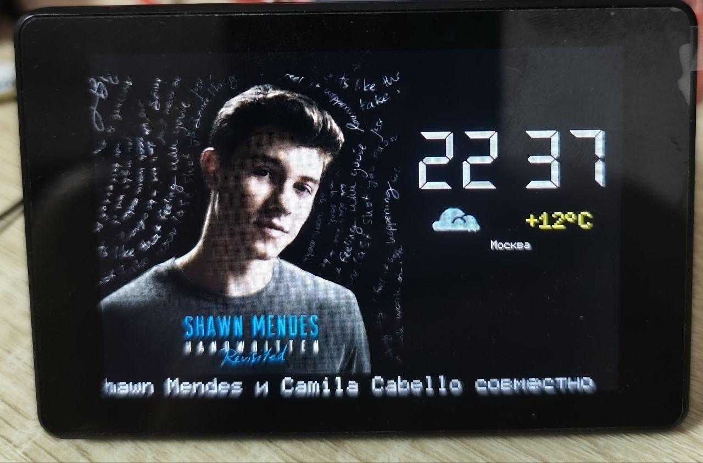
  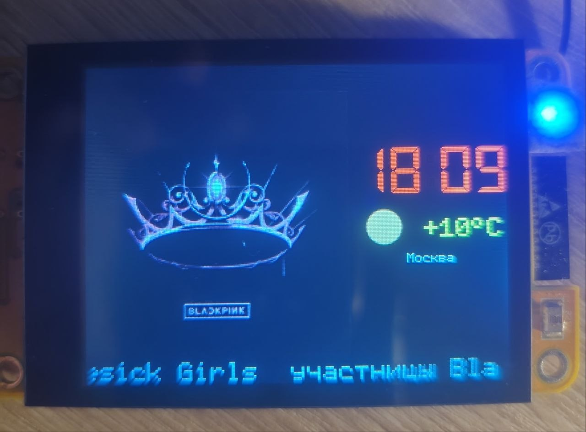
  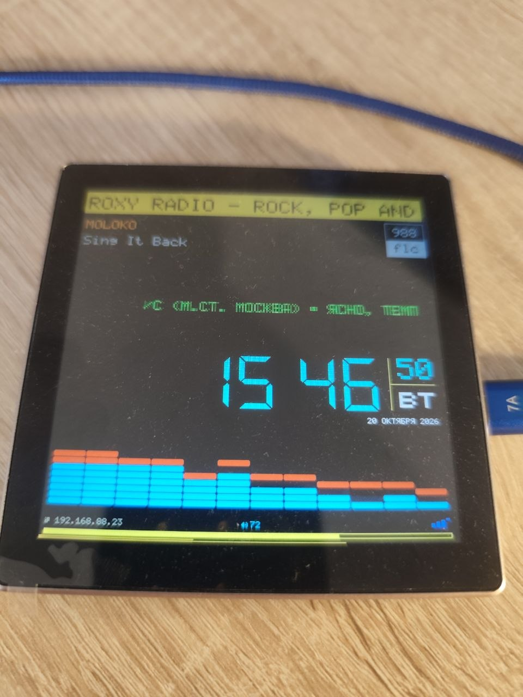
  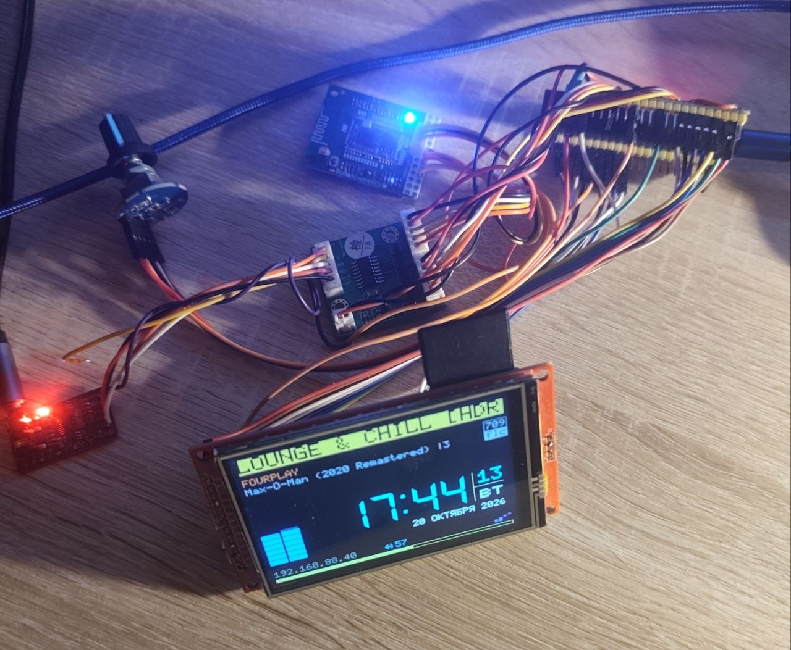
</p>

---

### 📑 Оглавление
- [Почему Arduino Core 3.x и обязательный PSRAM](#why-core3)
- [Главные отличия и функции](#features)
- [Железо и профили](#hardware)
- [Установка и сборка](#install)
- [Статус и планы](#status)
- [Известные шероховатости](#known-issues)
- [Документация](#docs)
- [История изменений](CHANGELOG.md)

---

<a name="why-core3"></a>
## ⚡ Почему Arduino Core 3.x и обязательный PSRAM?

В отличие от оригинального проекта, данная сборка жестко привязана к **3-му ядру (Arduino Core 3.x)** и **требует наличия PSRAM** на борту ESP32.

**Причины архитектурного решения:**
1. **Аудио-движок:** В моде используется сильно переработанная аудио-библиотека (основанная на моде `0.9.535(m)` с 4PDA). Современная версия этой библиотеки корректно работает *только* на 3-м ядре. (От интеграции самой свежей библиотеки от Wolle решено отказаться из-за проблем с определением битрейта, странной регулировкой громкости и фризами).
2. **Кэширование:** PSRAM активно используется для кэширования обложек альбомов, фактов о треках и буферизации потока. Старые чипы ESP32 без PSRAM аппаратно не «потянут» такой функционал без фатальных падений по памяти.
3. **Файловая система:** Полный отказ от SPIFFS. Проект работает исключительно на **LittleFS**, где также собирается весь кэш.

---

<a name="features"></a>
## 🚀 Главные отличия и функции

### 🎨 Интерфейс и управление
* **WebUI:** всплывающие окна, тултипы, анимированный логотип. Поиск по плейлисту (иконка лупы). Статистика использования PSRAM и FS прямо в веб-интерфейсе.

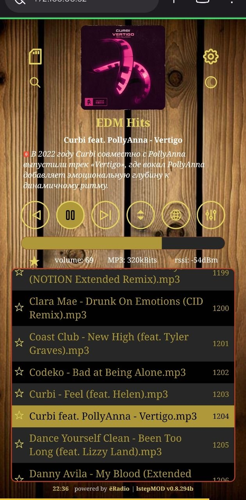

* **Smart Display:** на экране с тачскрином касание верхней части (по названию станции) листает источники по кругу — WEB, SD, DLNA, Bluetooth (что включено в сборке). Обложки на TFT при желании отключаются в WebUI (**Screen → Display Cover**) и в генераторе / `myoptions.h`.

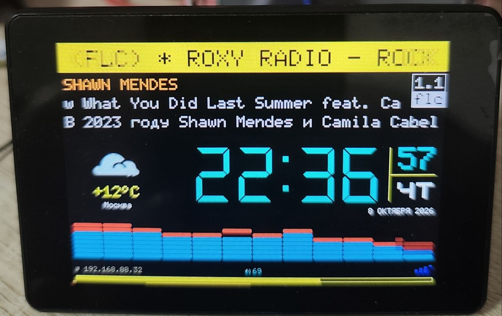

* **Файловый менеджер:** управление файлами LittleFS прямо из WebUI (с возможностью установки пароля).

### 📡 Источники звука
WEB-радио, **SD-карта**, **DLNA** (тестовый этап) и **Bluetooth** (QCC5125, в отладке). Режимы переключаются с экрана или из WebUI.

<p>
  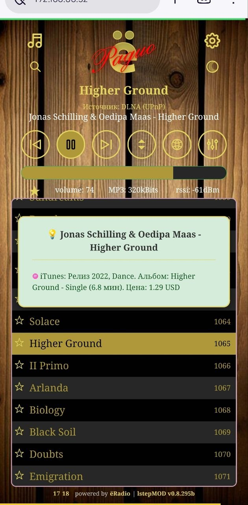
  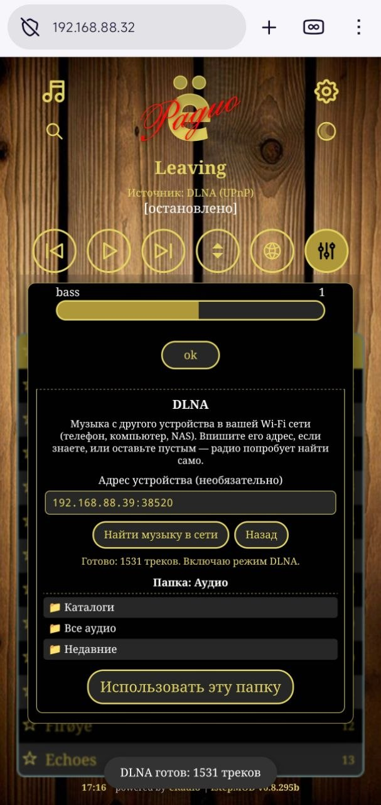
</p>

### 🧠 Плагин TrackFacts (AI-факты)
Интересные факты о текущей композиции. Провайдеры выбираются в WebUI.

По умолчанию запрос **ручной**: кнопка в WebUI или тап на устройстве; на экране с обложкой (screensaver) — **свайп вверх**. Звук идёт сразу, факт подтягивается по запросу. Если провайдер из домашней сети недоступен напрямую, устройство может ходить к нему через **прокси на самой плате** (настройка в WebUI / `myoptions`).

* *Рекомендация:* в реалиях РФ стабильнее всего работают **DeepSeek** и **iTunes**. Для Gemini и похожих AI часто помогает прокси на устройстве.

<p>
  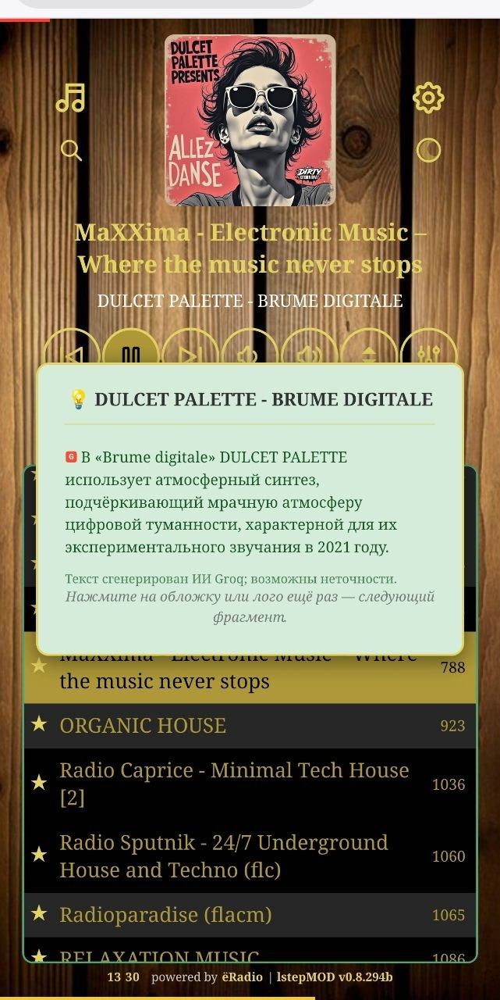
  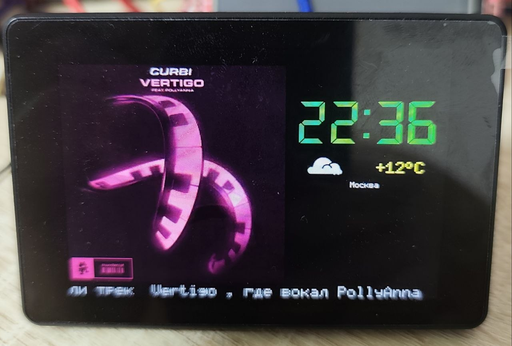
</p>

### ⚙️ Ядро и аудио
* **Watchdog и SmartStart:** логика восстановления потока и автостарта написана с нуля.
* **Регулировка громкости:** плавное линейное изменение от 0 до 100.
* **Питание и сон:** аппаратный таймер сна с управлением по заданному GPIO для физического отключения реле. Либо (при активной опции) глубокий сон (DeepSleep) с пробуждением по тачу или пину `wake_pin` (до 8 часов).
* **SD:** сохранение избранных треков при прослушивании музыки с SD-карты.
* **Сборка «из коробки» (S3):** кириллический шрифт 5×7 и сетевые библиотеки под тяжёлый FLAC собраны специально под Arduino-ESP32 3.3.6 и при сборке подставляются автоматически — руками в SDK ничего класть не нужно. Для env classic Wrover подставляются отдельные библиотеки из того же механизма.
* **Температура кристалла (опционально):** в `myoptions.h` можно включить `TEMP_DIAG_ENABLE` — раз в ~10 с в Serial строка `[TEMP]` с температурой кристалла SoC (это не радиатор и не корпус). По умолчанию выключено.

---

<a name="hardware"></a>
## 🔧 Железо и профили

Ручная правка `myoptions.h` часто съедает время (пин TFT, тач, ремап под S3). Проще взять **генератор профилей** [lstep.site/myoptions](https://lstep.site/myoptions/): выбрать профиль или собрать свой набор и сохранить как `src/myoptions.h`. В генераторе есть выбор модулей «что есть на плате», подсказки у опций, предупреждения по занятым GPIO и блок Advanced.

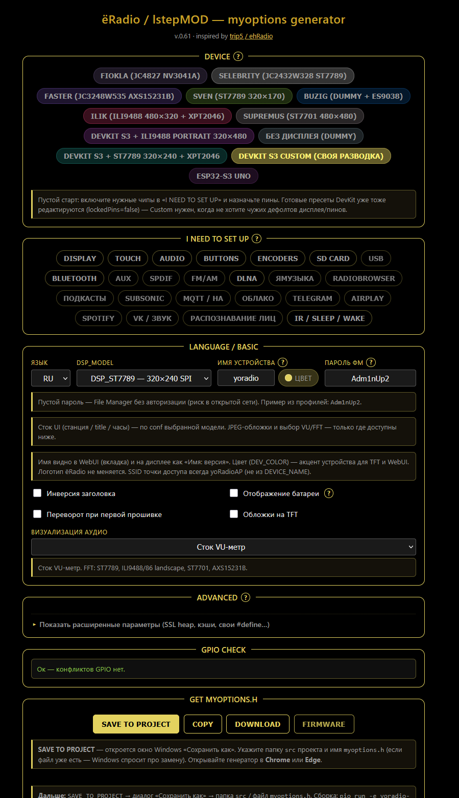

<p>
  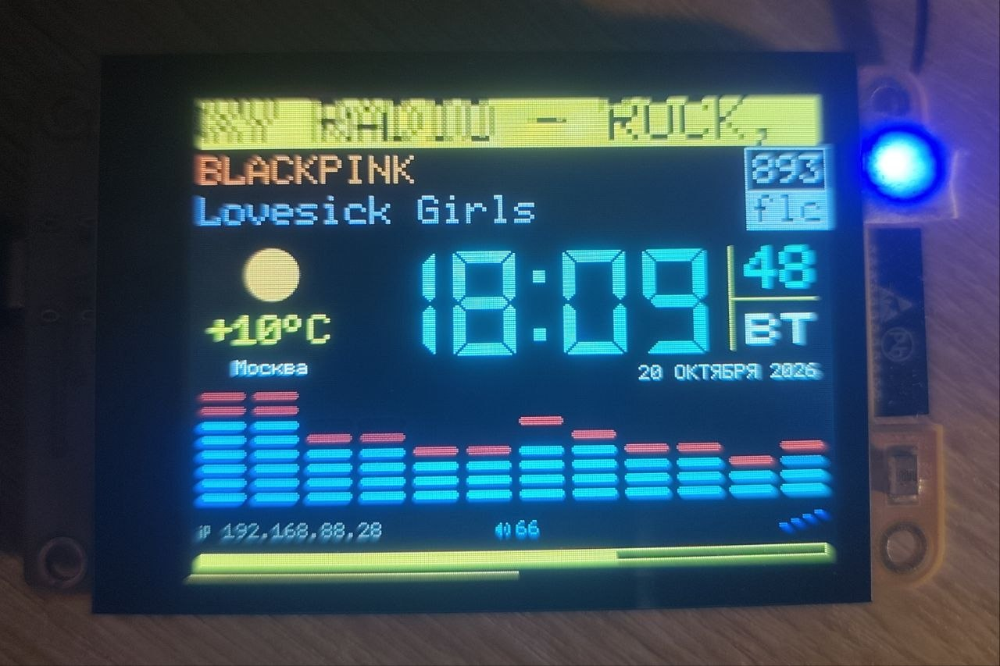
  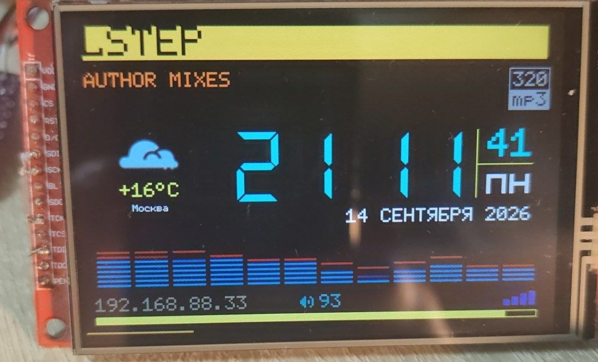
  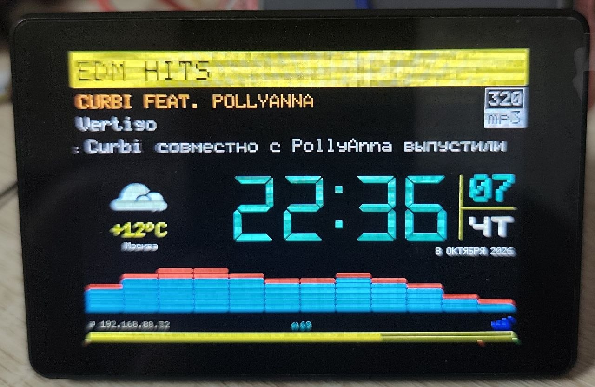
</p>

| Профиль | Плата | Экран / тач | ЦАП | Env | Заметки |
|---------|-------|-------------|-----|-----|---------|
| **Fiokla** | Guition JC4827W543 | NV3041A 480×272, GT911 | PCM5102 | `yoradio-esp32s3` | SD, BT, DLNA; обкатан 24/7 |
| **Buzig** | ESP32-S3 N16R8, без экрана | — | ES9038Q2M | `yoradio-esp32s3` | управление WebUI + ИК, DLNA; обкатан 24/7 |
| **Faster** | Guition JC3248W535 | AXS15231B 320×480, тач | PCM5102 | `yoradio-jc3248w535` | FFT-спектр; полевой; **пример `myoptions.h` в репо** |
| **Selebrity** | Guition JC2432W328 **после перепайки на N16R8** | ST7789 240×320, CST820 | PCM5102 | `yoradio-jc2432w328` | спектр, DLNA, SD |
| **ILIK** | ESP32-S3 DevKit | ILI9488 480×320, XPT2046 | PCM5102 | `yoradio-esp32s3` | энкодер, BT, ИК, DLNA, SD |
| **Sven** | ESP32-S3 DevKit | ST7789 320×170 | PCM5102 | `yoradio-esp32s3` | энкодер, DLNA |
| **Supremus** | ESP32-4848S040 | ST7701 RGB 480×480, GT911 | PCM5102 | `yoradio-4848s040` | **beta**; без BT и SD |
| **Aiwushka** | ESP32-WROVER N16R8 (classic, не S3) | этап без TFT (`DSP_DUMMY`); ST7789 — later | PCM5102 | `yoradio-esp32-wrover` | **эксперимент / доводка приостановлена**; не паритет с S3 |

> **Selebrity:** стоковая JC2432W328 (модуль N4R8) с этой прошивкой не работает — нужна перепайка на **N16R8**.

> **Aiwushka (Wrover):** env и classic-правки в коде есть, но профиль **ещё не доведён** (мало внутренней RAM у classic ESP32). Сейчас не цель «как Faster/S3». Свой `myoptions.h` под эту плату; в генераторе пока может не быть.

---

<a name="install"></a>
## 🛠 Установка и сборка
Проект собирается через **PlatformIO** (`pioarduino`).

1. Клонируйте репозиторий:
   ```bash
   git clone https://github.com/ldisco/yoradio_lstepMOD.git
   ```
2. Откройте в VS Code / Cursor (или Trae) с плагином PlatformIO.
3. Соберите профиль в [lstep.site/myoptions](https://lstep.site/myoptions/) и сохраните как `src/myoptions.h` (или настройте `myoptions.h` вручную).
4. Выберите env своего профиля (см. таблицу выше) в `platformio.ini`, соберите и прошейте (**Upload**).
5. Загрузите LittleFS (**Upload Filesystem Image**), при необходимости положив в `data/` свои `wifi.csv` и `playlist.csv`.
6. Пройдите Wi-Fi Setup и откройте WebUI по IP устройства.

> **Обновление со старых сборок:** прошивка стала больше и больше не помещалась в прежний объём flash под программу — пришлось увеличить разметку. Один раз прошейте по кабелю с **полным стиранием**, затем обычная прошивка и LittleFS. Дальше OTA в пределах этой линейки снова ок.

> **Для Arduino IDE:** [отдельный репозиторий](https://github.com/ldisco/yoradio_lstepMOD_arduino)

---

<a name="status"></a>
## 🔥 Статус и планы

**В работе** — чиним и доводим сейчас:
- Аудио: устойчивость веб-потоков и тяжёлых OGG/FLAC
- Одновременная работа Bluetooth + SD + тач
- Синхронизация Web ↔ устройство после перезагрузки или обрыва WebSocket; отзывчивость WebUI
- Supremus: картинка на экране и стабильность
- Доводка отображения на части других дисплеев
- Faster: обложка на screensaver, пирамидка погоды
- Визуализация папок в плейлисте SD/DLNA
- Общий кэш фактов между устройствами
- Цвет акцента: один тон на TFT и в WebUI

**Планы** — идеи на потом, без обещаний по срокам:
- Довести заготовки генератора до рабочих режимов (по одному): USB / AUX / FM·AM и другие источники
- Удобный выбор источника, когда режимов больше четырёх
- Кольцевое меню жестом на тач-экранах
- Прошивка из браузера и готовые `.bin` (сборка из исходников останется)
- Онлайн-редактор тем: [lstep.site/themes](https://lstep.site/themes/) (пока пусто)

---

<a name="known-issues"></a>
## ⚠ Известные шероховатости
- После перезагрузки или обрыва WebSocket Web и экран иногда расходились (F5; в Firefox на PC UI мог открыться пустым) — на DevKit правили, на других профилях ещё проверяем
- KEY громкости/play с модуля BT иногда расходится с WebUI; при громкости модуля «на максимуме» WEB может звучать тише
- Часть станций с тяжёлым OGG/FLAC на высоком битрейте ещё спотыкается
- При WEB+FLAC обложку на TFT рисует браузер, на экране устройства — логотип
- Фильтр TrackFacts иногда путает `[feat.]` со служебными `[…]` в теге
- DLNA — тестовый этап: играет, UX папок и стабильность доводим
- **Supremus (beta):** возможны рывки и артефакты картинки на экране — звук при этом приоритетнее
- **Aiwushka / classic Wrover:** веб и эфир на этой линейке ещё нестабильны относительно S3; доводка на паузе — не считать готовым профилем «из коробки»

---

<a name="docs"></a>
## 📚 Документация
- Bluetooth: `docs/bt_docs/`
- DLNA (пользовательское): `docs/dlna_docs/DLNA_USER_RU.md`
- Генератор: [lstep.site/myoptions](https://lstep.site/myoptions/)

---

[История изменений](CHANGELOG.md)

---

## 📜 Лицензия

**lstepMOD** — форк проекта [yoRadio](https://github.com/e2002/yoradio) (автор e2002), распространяется под лицензией **GNU GPL v3.0** — см. [LICENSE](LICENSE).

Модификации и доработки: © 2026 LStep.  
При использовании, форке или распространении этого мода просьба сохранять указание, что это именно **lstepMOD**, и ссылку на оригинальный проект e2002/yoradio.

Подробности атрибуции — см. [NOTICE.md](NOTICE.md).
