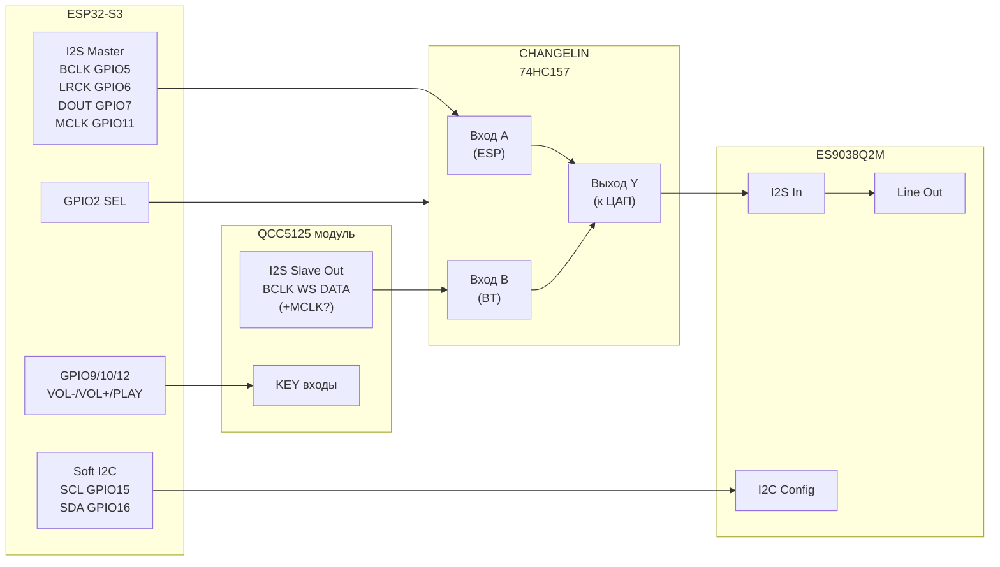

# Схема подключения: ESP32-S3 + CHANGELIN I2S-селектор + QCC5125 + ES9038Q2M

Прошивка **lstepMOD v0.8.202** (`USE_BT_I2S`), пины из `src/myoptions.h`.

Модули:
- [ESP32-S3-DevKitC-1 N16R8](https://docs.espressif.com/projects/esp-idf/en/latest/esp32s3/hw-reference/esp32s3/user-guide-devkitc-1.html)
- [CHANGELIN — 2/4-сторонний I2S/IIS аудио-модуль](https://aliexpress.ru/item/32948007762.html) (на базе **74HC157** или аналога)
- [Ziqqucu QCC5125 Bluetooth](https://aliexpress.ru/item/1005008627379562.html)
- **ES9038Q2M** (у вас уже подключён по I2C + I2S)

> **Важно:** на разных партиях AliExpress подписи на платах могут отличаться (`LCK` / `LRCK` / `WS`, `SD` / `DIN` / `DOUT`).  
> Сверьте **шелкографию на вашей плате** с таблицами ниже. Логика всегда одна: **два источника I2S → селектор → один вход ЦАП**.

---

## 1. Общая идея (одной фразой)

```
[ESP32-S3 I2S] ──┐
                 ├──► [CHANGELIN 74HC157] ──► [ES9038 I2S] ──► аналог OUT
[QCC5125 I2S]  ──┘         ▲
                           │
                    GPIO2 (SEL) от ESP
```

- **WEB/SD:** ESP — мастер I2S, селектор пропускает линии **от ESP** к ES9038.
- **BT:** ESP останавливает свой поток, селектор пропускает линии **от QCC5125** к ES9038; такты идут с BT-модуля.

Управление селектором: **GPIO2** (`BT_I2S_SEL_PIN`).

| Режим прошивки | GPIO2 (SEL) | Активный тракт |
|----------------|-------------|----------------|
| WEB / SD       | **LOW**     | ESP → ЦАП      |
| BT             | **HIGH**    | BT → ЦАП       |

(Если на плате «наоборот» — поменяйте в `myoptions.h`: `BT_I2S_SEL_LEVEL_BT` / `BT_I2S_SEL_LEVEL_ESP`.)

---

## 2. Блок-схема (mermaid)



---

## 3. Какие сигналы обязательно коммутировать

Для ES9038 и QCC5125 нужна **4-линейная** схема (берите **4-сторонний** CHANGELIN, не «только DATA»):

| Сигнал I2S | Назначение | ESP32-S3 (myoptions) | QCC5125 (типично) | → ES9038 |
|------------|------------|----------------------|-------------------|----------|
| **BCLK**   | битовый такт | GPIO **5** | BCK / BCLK | BCK |
| **LRCK/WS** | лево/право | GPIO **6** | LRCK / WS / LCK | LRCK / WS |
| **DATA**   | аудиоданные | GPIO **7** | DOUT / SD / DATA | DIN / DOUT |
| **MCLK**   | master clock | GPIO **11** | MCLK (если есть) | MCLK |

**Правило:** каждая из 4 линий: **ESP → вход A селектора**, **BT → вход B селектора**, **выход Y селектора → ES9038**.  
Не подключайте ESP и BT напрямую к ЦАП параллельно — будет конфликт и щелчки.

---

## 4. CHANGELIN (74HC157) — типовая распиновка

На платах CHANGELIN обычно есть **три группы** винтов/падов:

| Группа на плате | Куда подключать |
|-----------------|-----------------|
| **A / MCU / IIS1 / IN1** | I2S от **ESP32-S3** |
| **B / BT / IIS2 / IN2** | I2S от **QCC5125** |
| **Y / OUT / TO DAC** | I2S на **ES9038** |
| **SEL / S / A0** | **GPIO2** ESP (+ общий GND) |
| **VCC** | **3.3 V** (см. раздел питание) |
| **GND** | общая земля со всеми модулями |

### 4.1. Таблица «провод за проводом» (сторона ESP → селектор A)

| ESP32-S3 GPIO | Сигнал | → CHANGELIN вход **A** |
|---------------|--------|-------------------------|
| 5 | I2S_BCLK | BCLK_A |
| 6 | I2S_LRC  | LRCK_A / WS_A |
| 7 | I2S_DOUT | DATA_A / SD_A |
| 11 | I2S_MCLK | MCLK_A |

### 4.2. Сторона BT → селектор B

| QCC5125 (подпись на модуле) | → CHANGELIN вход **B** |
|-----------------------------|-------------------------|
| BCLK / BCK | BCLK_B |
| LRCK / WS / LCK | LRCK_B |
| DOUT / DATA / SD | DATA_B |
| MCLK (если выведен) | MCLK_B |

### 4.3. Выход селектора → ES9038

| CHANGELIN **Y / OUT** | → ES9038 |
|-----------------------|----------|
| BCLK_Y | BCLK |
| LRCK_Y | LRCK / WS |
| DATA_Y | DIN (data in) |
| MCLK_Y | MCLK |

---

## 5. QCC5125 (Ziqqucu) — что куда

Точные имена пинов смотрите на **вашей** плате (фото + мультиметр). Типичный breakout:

| Функция | Куда в системе |
|---------|----------------|
| **VCC** | 3.3 V (или 5 V **только** если модуль имеет стабилизатор/логику 5 V — см. маркировку) |
| **GND** | общий GND |
| **BCLK** | → CHANGELIN **B** BCLK |
| **LRCK / WS** | → CHANGELIN **B** LRCK |
| **DOUT / DATA** | → CHANGELIN **B** DATA |
| **MCLK** | → CHANGELIN **B** MCLK (если есть; иначе оставить не подключённым и проверить звук) |
| **KEY / PLAY** | → GPIO **12** ESP (через резистор 100 Ω–1 kΩ при сомнениях) |
| **KEY VOL+** | → GPIO **9** |
| **KEY VOL−** | → GPIO **10** |
| Антенна | как на модуле (не укорачивать без необходимости) |

**KEY:** прошивка даёт импульс **HIGH ~50 ms** (3.3 V). Общий GND модуля BT и ESP обязателен.

Сопряжение Bluetooth — **на телефоне**, подключение к имени модуля QCC5125; отдельный провод «pair» в прошивке не выведен (можно позже добавить на свободный GPIO).

---

## 6. ES9038 — что уже есть и что добавить

У вас уже:

| ES9038 | ESP32-S3 |
|--------|----------|
| SCL | GPIO **15** |
| SDA | GPIO **16** |

I2S на ES9038 должен приходить **только с выхода CHANGELIN (Y)**, не напрямую с ESP:

```
Было (без BT):  ESP I2S ──────────────► ES9038
Стало (с BT):   ESP I2S ──► MUX A ──┐
                  BT I2S ──► MUX B ──┼──► MUX Y ──► ES9038
```

Питание и аналоговая часть ES9038 — без изменений.

---

## 7. Управление и прочие провода ESP

| GPIO | Назначение |
|------|------------|
| 2 | SEL селектора CHANGELIN |
| 4 | WAKE / IR (не трогать) |
| 5,6,7,11 | I2S → MUX A |
| 9,10,12 | KEY → QCC5125 |
| 15,16 | I2C → ES9038 |
| 18 | Sleep timer (если используется) |
| 39,40,41,42 | SD SPI (если SD вставлена) |

---

## 8. Питание и земля

```
        ┌─────────────┐
  3.3V ─┤ ESP32-S3    ├── GND ───┬── CHANGELIN GND
        │             │          ├── QCC5125 GND
        │             │          ├── ES9038 GND
        └─────────────┘          └── (питание усилителя)

  3.3V ──► CHANGELIN VCC (если плата на 3.3 V логике)
  3.3V ──► QCC5125 VCC (проверьте даташит/подпись на модуле!)
```

- **Одна общая точка GND** для всех модулей (звезда или плоская шина — короткие провода).
- Ток BT-модуля при передаче может быть заметным: питание QCC5125 лучше с **отдельного** 3.3 V (≥500 mA), а не «с одного пина» ESP.
- Развязка: **100 nF** у VCC каждой платы, у ES9038 по рекомендации производителя.

---

## 9. ASCII-схема «в разрезе»

```
                    ┌──────────────── CHANGELIN ────────────────┐
                    │  A (ESP)          B (BT)         Y (DAC) │
  ESP GPIO5  BCLK ──┼── BCLK_A          BCLK_B ─────── BCLK_Y ──┼──► ES9038 BCLK
  ESP GPIO6  LRCK ──┼── LRCK_A          LRCK_B ─────── LRCK_Y ──┼──► ES9038 LRCK
  ESP GPIO7  DOUT ──┼── DATA_A          DATA_B ─────── DATA_Y ──┼──► ES9038 DIN
  ESP GPIO11 MCLK ──┼── MCLK_A          MCLK_B ─────── MCLK_Y ──┼──► ES9038 MCLK
  ESP GPIO2  SEL ───┼── SEL                                     │
                    └───────────────────────────────────────────┘
                              ▲                    ▲
                              │                    │
  QCC5125 BCLK/WS/DATA/MCLK ───┘                    │
                                                   │
  ESP GPIO15/16 ───────────── I2C ─────────────────┼──► ES9038 config (SCL/SDA)

  ESP GPIO9/10/12 ─────────── KEY ────────────────► QCC5125 KEY pads
```

---

## 10. Порядок сборки (рекомендуемый)

1. **ES9038 + ESP** — проверить WEB/SD **без** BT (MUX: все Y пока можно временно с A, SEL=LOW).
2. Подключить **CHANGELIN**: только линии A от ESP → Y → ES9038; звук WEB/SD должен остаться.
3. Подключить **QCC5125** на вход B селектора (BCLK, LRCK, DATA, MCLK).
4. Подключить **SEL** на GPIO2, **KEY** на 9/10/12.
5. Прошить **v0.8.202** + LittleFS, в WebUI: `btSupported=1`, цикл **WEB → BT**.
6. Осциллограф (желательно): в BT на Y должны быть такты с модуля BT; в WEB — с ESP.

---

## 11. Частые ошибки

| Ошибка | Следствие |
|--------|-----------|
| ESP и BT напрямую на ES9038 | конфликт, шум, нет звука |
| Переключен только DATA, без BCLK/LRCK/MCLK | нет звука или свист |
| SEL не подключён / плавает | случайный источник, щелчки |
| Разные GND | гул, обрывы BT |
| 5 V на логику 3.3 V | риск для ESP/ЦАП |
| KEY без общего GND | громкость не работает |

---

## 12. Если подписи на CHANGELIN не совпадают

Сфотографируйте плату крупно (обе стороны) и сопоставьте:

1. Найдите **SEL** — обычно идёт на ножку `A0`/`1A/1B` 74HC157.
2. Найдите **4 пары** рядом: `1A+1B→1Y`, `2A+2B→2Y` … для BCLK, LRCK, DATA, MCLK.
3. Группа **A** — к ESP, **B** — к BT, **Y** — к ES9038.

---

## См. также

- Пользовательская инструкция WebUI: [BT_USER_RU.md](BT_USER_RU.md)
- План интеграции: [../plans/bt_i2s_universal_integration_7806dc32.plan.md](../plans/bt_i2s_universal_integration_7806dc32.plan.md)
